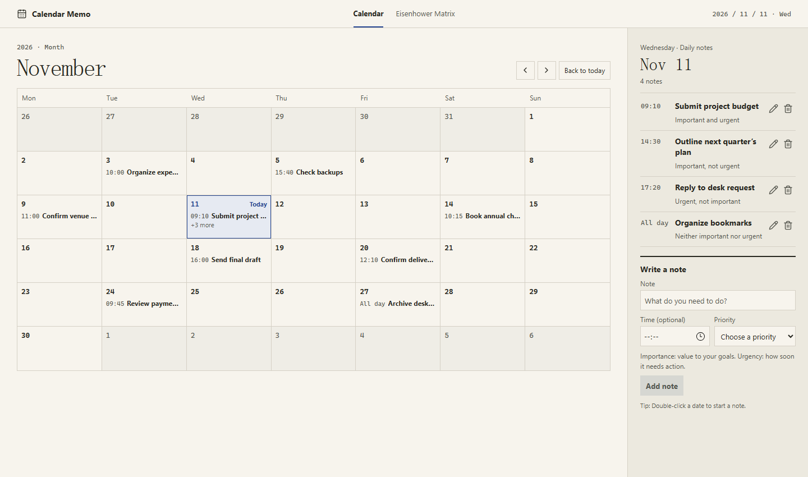
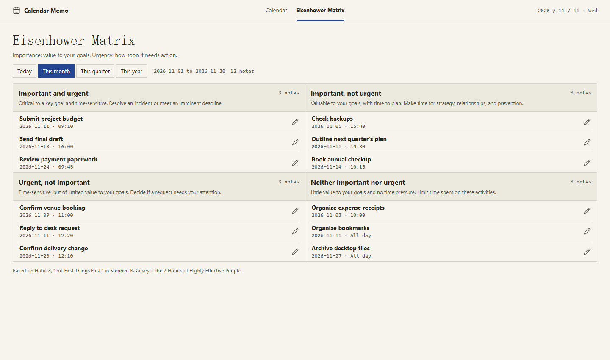

# Calendar Memo

English · [简体中文](README.zh-CN.md)

A lightweight, offline calendar notebook for Windows. Plan the month, keep notes by date and time, and review priorities on an Eisenhower Matrix board.

## Demo

The English screenshots are localized illustrations with sample notes. The downloadable app currently uses Simplified Chinese.

### Desk calendar



### Eisenhower Matrix



## Quick start

1. Download [CalendarMemo-Standalone.html](CalendarMemo-Standalone.html) with GitHub’s **Download raw file** button, or download the repository ZIP.
2. Double-click the HTML file in File Explorer. No account or server is required.
3. Select a date, write a note, optionally set a time, choose a priority, and save. Double-click a date to focus the note field. Click the month heading to jump to another month or year.

Notes are saved in the browser. After an upgrade, open the file from the same path and browser profile to keep access to your notes. Private browsing and clearing browser storage can remove saved notes.

## Priority board

The four groups follow Habit 3, “Put First Things First,” from Stephen R. Covey’s *The 7 Habits of Highly Effective People*. You choose each note’s priority:

- **Important and urgent:** address a critical issue or an imminent deadline.
- **Important, not urgent:** make time for planning, relationships, and prevention.
- **Urgent, not important:** decide whether a time-sensitive interruption needs your attention.
- **Neither important nor urgent:** spend less time on low-value activities.

Filter by **Today**, **This month**, **This quarter**, or **This year**. Ranges use your computer’s local date and calendar quarters. Month, quarter, and year include scheduled future dates in that period. Click a note to edit it in the calendar. Older notes without a priority appear under **Uncategorized**.

## Development

```powershell
npm ci
npm run dev
npm run build:standalone
```

The browser preview uses browser storage; the Tauri desktop app uses SQLite in its app data directory. After installing the Windows [Tauri prerequisites](https://v2.tauri.app/start/prerequisites/), run `npm run tauri dev` for desktop development or `npm run tauri build` to build a Windows installer. The NSIS output goes to `src-tauri/target/release/bundle/nsis/`.
