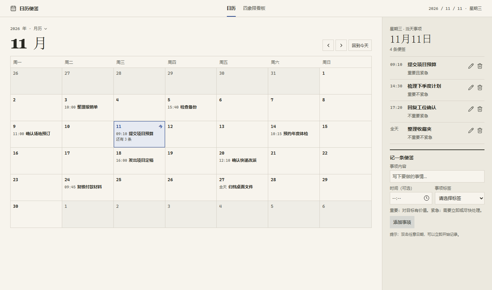
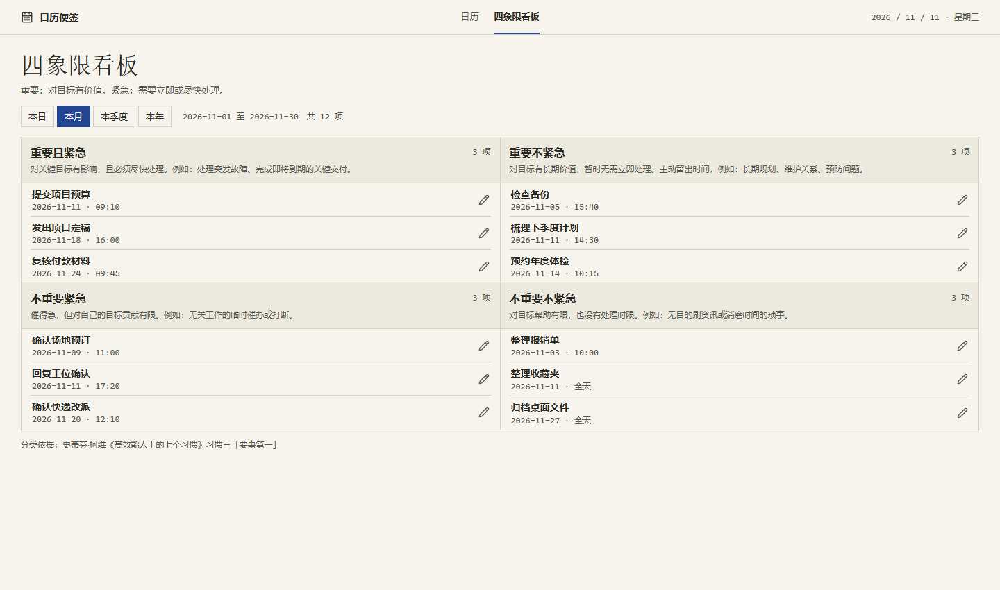

# 日历便签

[English](README.md) · 简体中文

一款面向 Windows 的轻量离线日历备忘录：查看整月安排，按日期和时间记录便签，再用四象限看板回顾优先级。

## 界面演示

以下截图使用虚构便签。正式版界面为简体中文；英文示意见 [英文 README](README.md)。

### 案头月历



### 四象限看板



## 快速开始

1. 打开 [CalendarMemo-Standalone.html](CalendarMemo-Standalone.html)，点击 GitHub 的 **Download raw file**，也可下载仓库 ZIP。
2. 在资源管理器双击 HTML 文件即可离线使用，无需服务器或账号。
3. 选定日期、填写事项、按需设置时间、选择标签并保存。双击日期可直接聚焦录入区；点击月份标题可跳转年月。

便签保存在浏览器中。升级后请用同一浏览器配置从原路径打开文件，以便继续读取旧记录。无痕浏览或清除浏览器存储可能导致记录丢失。

## 四象限看板

分类参考史蒂芬·柯维《高效能人士的七个习惯》习惯三「要事第一」。重要性看事项对目标的价值，紧急性看是否需要尽快处理，由你自行选择：

- **重要且紧急**：处理关键问题或迫近的交付。
- **重要不紧急**：主动安排长期规划、关系维护和预防工作。
- **不重要紧急**：判断是否需要立即回应临时打断。
- **不重要不紧急**：减少在低价值琐事上的投入。

可按 **本日、本月、本季度、本年** 筛选，以电脑当前本地日期为准，季度按自然季度计算。月、季、年范围包含该期间的未来事项。点击看板便签可跳回日历编辑；旧版未加标签的便签归在「未分类」。

## 本地开发

```powershell
npm ci
npm run dev
npm run build:standalone
```

浏览器预览使用浏览器存储，Tauri 桌面版使用应用数据目录中的 SQLite。安装 [Tauri 的 Windows 前置依赖](https://v2.tauri.app/start/prerequisites/) 后，可运行 `npm run tauri dev` 启动桌面开发版，或用 `npm run tauri build` 构建安装包。NSIS 产物位于 `src-tauri/target/release/bundle/nsis/`。
